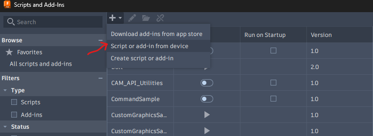
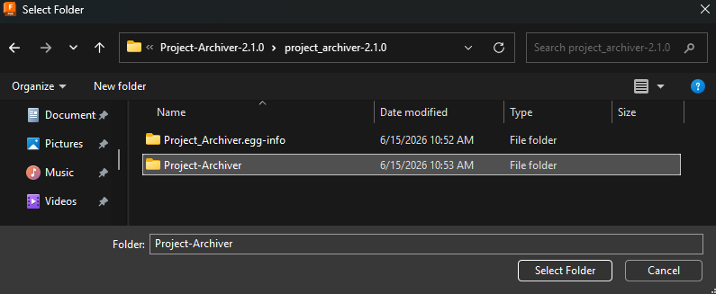
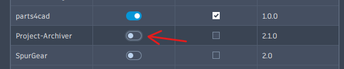
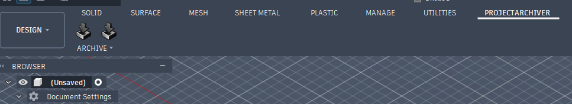
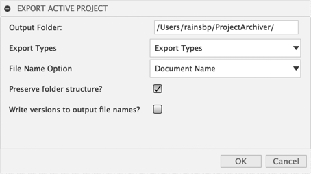

# Project-Archiver
The archiver script will open all Fusion 360 3D data in a project and export it as STEP to a local location of your choosing. 

[How to install](#How-to-install)  
[How to use](#How-to-use)   
[For Developers](#For-Developers)

----

### How to install
1. Download **Project-Archiver.zip** from the [latest release](https://github.com/tapnair/Project-Archiver/releases/latest/download/Project-Archiver.zip)

*Don't use the "Source code" downloads. They extract to a folder with the version in its name, and Fusion won't load it.*

2. Unzip the archive to a permanent location on your computer

### Fusion 360  

1. Launch Fusion 360.
2. On the main toolbar click the **Scripts and Addins** button in the **Addins** Pane

	

3. Click the "+" at the top and select **Script or add-in from device**

    

4. Browse to the **Project-Archiver** sub-folder in the unzipped folder

   

5. Find Project-Archiver in the add-in list and click the run toggle switch.

   

6. In the **Design** workspace, click the **Tools** tab and you should see the **Archive** panel and commands.

	

----

### How to use

In the data panel navigate to the project you want to archive.
The add-in will export all Fusion 360 files in the active project.

It then allows you to enter a path. Type in a path into the **Output Path** field.
* For OSX this might be: **/Users/*username*/Desktop/Test/**
* For Windows this might be something like **C:\Test**

Under **Export Types** select the different files types you want to export.  You can select multiple types.

#### Electronics documents

Electronics documents (prj/sch/brd/lbr) can also be archived. Select the **BRD**, **SCH**, or **LBR** export types to output the corresponding EAGLE files.

File Name Options allow you to specify the naming convention for output files.  
If you select 'Document Name' you can choose whether or not to append the version number to the file name.

Click **OK**.

Fusion will open and export each 3D design. Depending on the size of design and bandwidth this can take some time. 
Fusion 360 will be busy for the duration of the script running, so it would be advisable to run this on a dedicated machine that you can leav to run for some time. 

### For Developers
This add-in is built on the standard Fusion Python add-in template and has no external dependencies.

1. Clone the repo
2. In Fusion, open **Scripts and Add-Ins**, click the "+" and select **Script or add-in from device**
3. Browse to the **Project-Archiver** sub-folder of the cloned repo

See [Python Add-in Template](https://help.autodesk.com/view/fusion360/ENU/?guid=GUID-DF32F126-366B-45C0-88B0-CEB46F5A9BE8) for details on the add-in structure.

## License
Licensed under the terms of the [Apache License, Version 2.0](https://www.apache.org/licenses/LICENSE-2.0). Please see the [LICENSE](LICENSE) file for full details.

## Written by

Written by [Patrick Rainsberry](https://twitter.com/prrainsberry)   (Autodesk Fusion 360 Product Manager)

See more useful [Fusion 360 Utilities](https://tapnair.github.io/index.html)

Analytics

