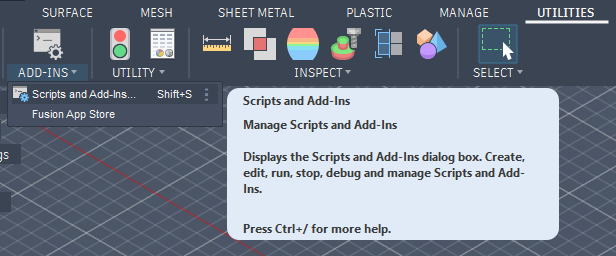
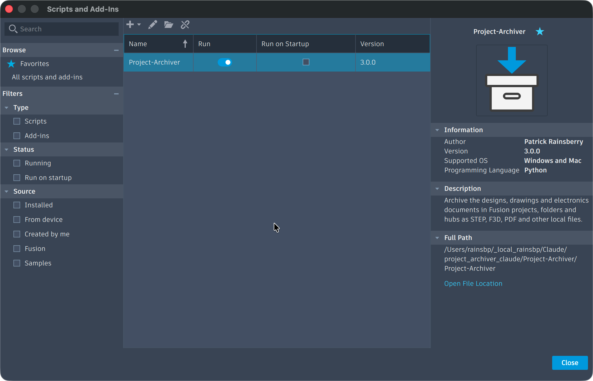
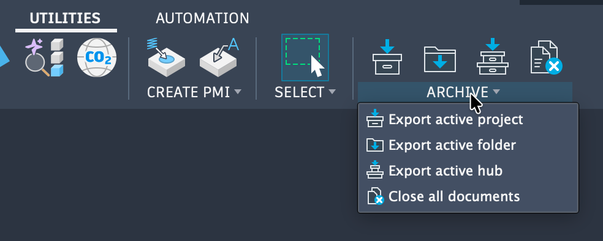
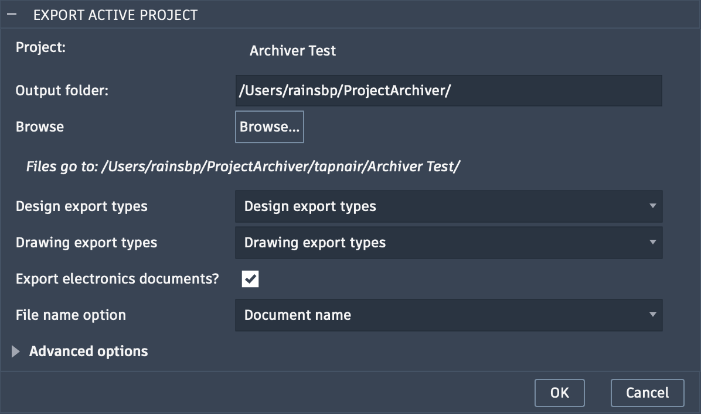
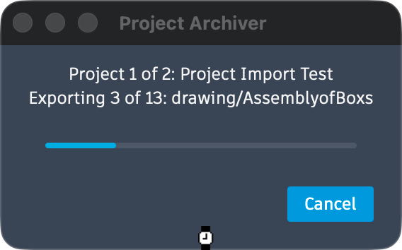
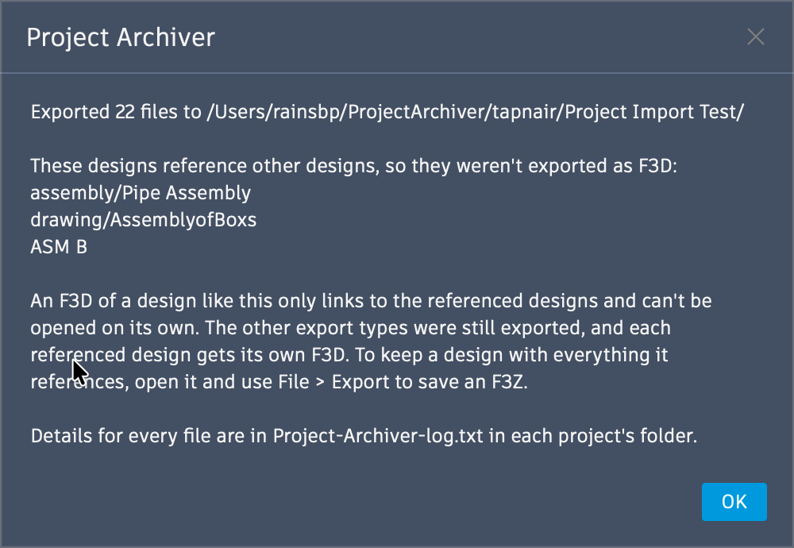
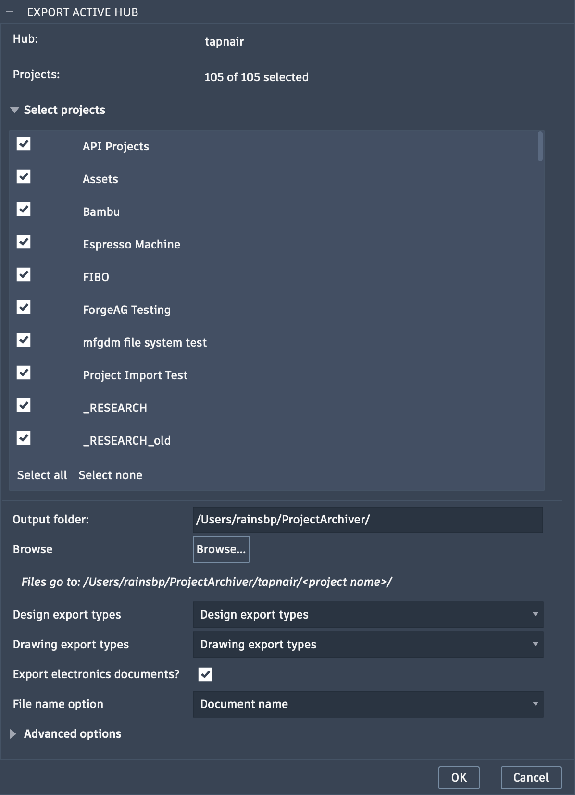
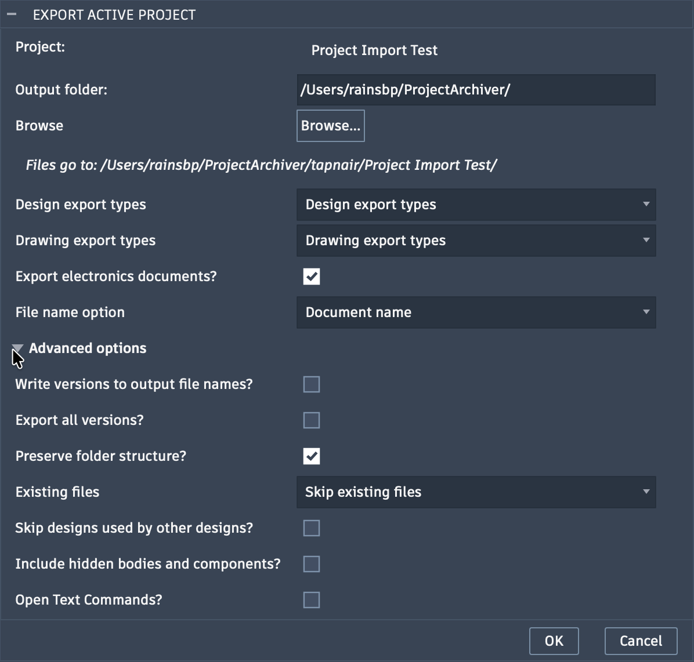

# Project Archiver

Project Archiver is an add-in for Autodesk Fusion that exports the designs, drawings and electronics documents in your Fusion projects to files on your computer. Use it to keep a local archive of a project or a whole hub, to hand data to someone who doesn't use Fusion, or to back up projects before reorganizing them.

**New in 3.0.0:** Export active hub and Export active folder, drawings, all versions, progress with cancel, a log of every file and more. See the [release notes](RELEASE_NOTES.md).

- [What it does](#what-it-does)
- [Download and install](#download-and-install)
- [Commands](#commands)
- [Archive a project](#archive-a-project)
- [Options](#options)
- [What you get](#what-you-get)
- [Tips and limitations](#tips-and-limitations)
- [Troubleshooting](#troubleshooting)
- [For developers](#for-developers)
- [License](#license)

## What it does

- Exports every **design** to STEP, IGES, SAT, SMT, STL and F3D, in any combination.
- Exports every **drawing** to PDF, DXF and DWG, with all sheets in one file.
- Exports every **electronics** schematic, board and library to EAGLE .sch, .brd and .lbr files.
- Archives a **folder**, a whole **project**, or the projects you choose from a **hub**.
- Exports the latest version of each design, or **every version**.
- Keeps the hub, project and folder structure, and makes names safe to use as file names on Windows and macOS.
- Closes each design after exporting it, so even large projects don't run Fusion out of memory.
- Shows **progress** with a Cancel button, and can pick up where a cancelled export stopped.
- Writes a **log** of every file and ends with a summary of anything that was skipped or failed.

## Download and install

1. Download **Project-Archiver.zip** from the [latest release](https://github.com/tapnair/Project-Archiver/releases/latest/download/Project-Archiver.zip).

   *Use this file, not the "Source code" downloads on the [Releases page](https://github.com/tapnair/Project-Archiver/releases/latest). Those unzip to a folder with the version in its name, and Fusion only loads an add-in from a folder with the same name as the add-in.*

2. Unzip it to a permanent location on your computer. You get a folder named **Project-Archiver**.

3. In Fusion, click **Utilities > Add-Ins > Scripts and Add-Ins**, or press **Shift+S**.

   

4. Click **+** and choose **Script or add-in from device**.

   

5. Select the **Project-Archiver** folder you unzipped.

   

6. Find **Project-Archiver** in the list and turn on **Run**. Select **Run on Startup** too if you want it every time Fusion starts.

   

7. In the **Design** workspace, the **Utilities** tab now has an **Archive** panel.

   

To update to a new version, stop the add-in in Scripts and Add-Ins, replace the Project-Archiver folder with the new one, and turn on **Run** again.

## Commands

All the commands are in **Utilities > Archive** in the Design workspace. The export commands work on whatever is selected in Fusion's **Data Panel**.

| Command | What it does |
|---|---|
| **Export active project** | Exports the whole project selected in the Data Panel. |
| **Export active folder** | Exports the folder open in the Data Panel and its subfolders. At the top of a project, it's the same as Export active project. |
| **Export active hub** | Exports the projects you choose from the hub open in the Data Panel. |
| **Close all documents** | Closes every saved document, including designs loaded in the background for an assembly. Unsaved documents stay open. The export commands run it automatically when they finish. |

## Archive a project

1. In the **Data Panel**, select the project you want to archive. To archive only part of it, open the folder you want. To archive several projects, open the hub.
2. Click **Utilities > Archive** and choose **Export active project**, **Export active folder** or **Export active hub**.
3. Check the **Project**, **Folder** or **Hub** shown at the top of the dialog. Choose the export types and the output folder; the line below the output folder shows exactly where the files will go. Click **OK**.

   

4. A progress dialog shows each file as it's exported. Click **Cancel** to stop after the file in progress. If the progress dialog comes back after you click Cancel, click Cancel again: drawings and electronics documents switch Fusion's workspace, which closes the dialog, so a click during one of those files isn't counted. Fusion is busy until the export finishes, so on a large project or hub, start it when you won't need Fusion for a while.

   

5. When it's done, the add-in closes the documents it opened and shows a summary: how many files were exported and where, and anything that was skipped or couldn't be exported.

   

### Archive a hub

**Export active hub** works the same way, with two differences:

- **Choose the projects.** The **Projects** line shows how many projects are selected; all of them are to start with. Click **Select projects** to choose, with **Select all** and **Select none** to help with long lists.

  

- **Confirm the size.** After you click OK, the add-in counts the documents in the selected projects and asks you to confirm, for example "This will export 12 projects from My Hub, with about 1,240 documents". The count is an estimate: it includes every file in the projects' folders and doesn't include older versions.

The projects are exported one at a time, each into its own folder with its own log. Cancel stops the whole hub export.

## Options

### Main options

| Option | Default | What it does |
|---|---|---|
| **Project**, **Folder** or **Hub** | | What will be exported, from the Data Panel. Read-only. |
| **Projects** and **Select projects** | All projects | Export active hub only. How many projects are selected, and a list to choose them. **OK** isn't available until at least one project is selected. |
| **Output folder** | `~/ProjectArchiver/` | The folder to export into. Type a path or click **Browse...**. Files always go into a folder for the hub and one for each project inside it, so the same output folder works for every command and every project. |
| **Files go to** | | Read-only. The full path the files will go to, for example `~/ProjectArchiver/My Hub/My Project/`. It updates as you change the output folder or **Preserve folder structure**. |
| **Design export types** | STEP | Formats for each design: **IGES**, **STEP**, **SAT**, **SMT**, **F3D** and **STL**. Uncheck them all to skip designs. |
| **Drawing export types** | PDF | Formats for each drawing: **PDF**, **DXF** and **DWG**. Each drawing exports to one file per type, with every sheet in it. Uncheck them all to skip drawings. |
| **Export electronics documents?** | On | Exports each schematic as .sch, each board as .brd and each library as .lbr (EAGLE 9.6.2 formats). Only shown when your version of Fusion can export electronics documents. |
| **File name option** | Document name | How exported designs are named: by **Document name**, or by the root component's **Description** or **Part number**. If the description or part number is empty, the document name is used. Drawings and electronics documents always use the document name. |

**OK** is only available when at least one export type is selected.

### Advanced options

Click **Advanced options** to see these.



| Option | Default | What it does |
|---|---|---|
| **Write versions to output file names?** | Off | Adds the version number to each file name, for example `Bracket v4.step`. |
| **Export all versions?** | Off | Exports every version of each design and drawing, not only the latest, and always adds the version to the file names. Before exporting a project or folder, the add-in counts the versions, tells you how many files it will export and asks you to confirm. Electronics documents are exported at their latest version only. |
| **Preserve folder structure?** | On | Recreates the project's folders inside its project folder. Turn it off to put all of a project's files directly in its project folder. Each project still gets its own folder either way. |
| **Existing files** | Skip existing files | What to do when a file with the same name is already there: **Skip existing files**, **Rename with -dup** (adds `-dup` to the new file's name) or **Overwrite**. Skipping makes it quick to rerun an export, for example to finish one you cancelled: designs whose files all exist aren't even opened when they're named by document name. |
| **Skip designs used by other designs?** | Off | Only exports designs that aren't inserted into another design, such as top-level assemblies. A drawing of a design doesn't count as using it. |
| **Include hidden bodies and components?** | Off | Before exporting STEP, IGES, SAT, SMT and STL, shows every hidden body and component at every level of the design, so they're included. F3D files always keep hidden geometry, still hidden. Designs you already had open are hidden again afterward. |
| **Open Text Commands?** | Off | Opens Fusion's Text Commands window when the export starts, where each file is listed as it's exported. |

## What you get

**Folders.** With the default output folder, a design ends up in:

```
~/ProjectArchiver/<hub>/<project>/<folders in the project>/<design>.step
```

Every export command uses this layout. Export active folder puts a folder's files where an export of the whole project would put them, and Export active hub puts each project where Export active project would. So you can archive a large project one folder at a time, or a hub one project at a time, and end up with the same archive.

**File names.** Characters that aren't allowed in file names on Windows or macOS (`\ / : * ? " < > |`) become `-`. Trailing spaces and periods are removed, and Windows reserved names such as `CON` get a `-` added. Hub, project, folder and design names are all cleaned up this way, the same on every computer, so an archive can move between Windows and macOS. For example, a design named `Bracket 1/8" thick` exports as `Bracket 1-8- thick.step`.

**Logs.** Each project folder has a **Project-Archiver-log.txt** listing every file with what was written, or why it was skipped or failed, along with the options used. Each export adds to the end of the log, so reruns keep their history. A hub export also writes a short log in the hub folder with each project's totals. If you're helping someone with an archive, ask for these files first.

**Your open documents.** Documents you had open before the export stay open. Everything the export opened is closed again.

## Tips and limitations

- **Designs that reference other designs aren't exported as F3D.** An F3D of an assembly that inserts other designs only contains links to them, and Fusion can't open it on its own ("New design cannot be created from a local file containing external references"). Its STEP and other formats are still exported, and each referenced design gets its own F3D. To keep an assembly with everything it references in one file, open it and use **File > Export** to save an **F3Z**; add-ins can't create F3Z files. The summary lists these designs.
- **Large exports take a while.** A STEP export of a 317-design project took about 27 minutes on a Mac. Fusion is busy for the whole export, apart from the Cancel button. For a hub, start with a few projects to see how long they take.
- **Memory.** Each design is closed right after it's exported. Designs that an assembly references load in the background, without their own tab, and Fusion sometimes keeps them loaded until the export finishes. A single very large design still needs its own memory while it's open.
- **Older versions of open designs.** With **Export all versions**, Fusion can't open an older version of a design while that design is open, either in a tab or in the background for an assembly. Those versions are listed as could not be opened. Close the design and export again with **Skip existing files** to fill them in.
- **Preview features.** DXF and DWG drawing export and electronics export use Fusion API features that are still in preview and may change. If one isn't available in your version of Fusion or fails, it's listed in the summary and the rest of the export continues.
- **What isn't exported.** Other file types in a project, such as uploaded PDFs or non-Fusion CAD files, aren't exported; the log lists them. An electronics design (.fprj) isn't exported separately, because its schematic and board are separate files in the same folder.

## Troubleshooting

| Problem | What to do |
|---|---|
| Project-Archiver doesn't appear in Scripts and Add-Ins, or won't load | Make sure you selected the folder named exactly **Project-Archiver**, the one that contains Project-Archiver.py. If you downloaded a "Source code" zip, download **Project-Archiver.zip** from the [latest release](https://github.com/tapnair/Project-Archiver/releases/latest) instead. |
| "Fusion could not find an active project" (or folder, or projects in the hub) | Open the **Data Panel**, navigate to the project, folder or hub you want to archive, and run the command again. |
| A file is listed as could not be opened | Open it in Fusion to see why. An upload that never finished processing in the cloud, for example, can't be opened. If it was open in Fusion during an all-versions export, close it and export again with **Skip existing files**. |
| The summary says files were skipped because they already exist | The output folder already has files with those names. Choose **Overwrite** or **Rename with -dup** under **Advanced options**, or choose a different output folder. |
| Something else went wrong | Check **Project-Archiver-log.txt** in the project's folder, and [open an issue](https://github.com/tapnair/Project-Archiver/issues) with the log attached. |

## For developers

Project Archiver is built on Fusion's standard Python add-in template and has no external dependencies. To run it from source:

1. Clone the repo.
2. In Fusion, open **Scripts and Add-Ins**, click **+** and choose **Script or add-in from device**.
3. Select the **Project-Archiver** folder inside the cloned repo.

| Path | Contents |
|---|---|
| `Project-Archiver/Project-Archiver.py` | The add-in's entry point, unchanged from the template |
| `Project-Archiver/config.py` | The add-in's name, IDs and where the Archive panel goes |
| `Project-Archiver/commands/` | One folder per command (`exportProject`, `exportFolder`, `exportHub`, `closeAll`), each with its icons |
| `Project-Archiver/lib/archiverUtils/` | The export itself. Start with `exporter.py`, which explains the steps of an export, and `document_utils.py`, which covers the Fusion behavior the export works around. `export_dialog.py` is the dialog the export commands share. |
| `Project-Archiver/lib/fusionAddInUtils/` | Event and logging helpers from the template |

See [Python add-in template](https://help.autodesk.com/view/fusion360/ENU/?guid=GUID-DF32F126-366B-45C0-88B0-CEB46F5A9BE8) in the Fusion API documentation for how the template is organized.

## License

Copyright (c) 2019-2026 Patrick Rainsberry. Licensed under the [Apache License, Version 2.0](https://www.apache.org/licenses/LICENSE-2.0). See [LICENSE](LICENSE) for details.

## Written by

Written by [Patrick Rainsberry](https://twitter.com/prrainsberry), with fixes and ideas from the people listed in the [release notes](RELEASE_NOTES.md).

See more [Fusion utilities](https://tapnair.github.io/index.html).
